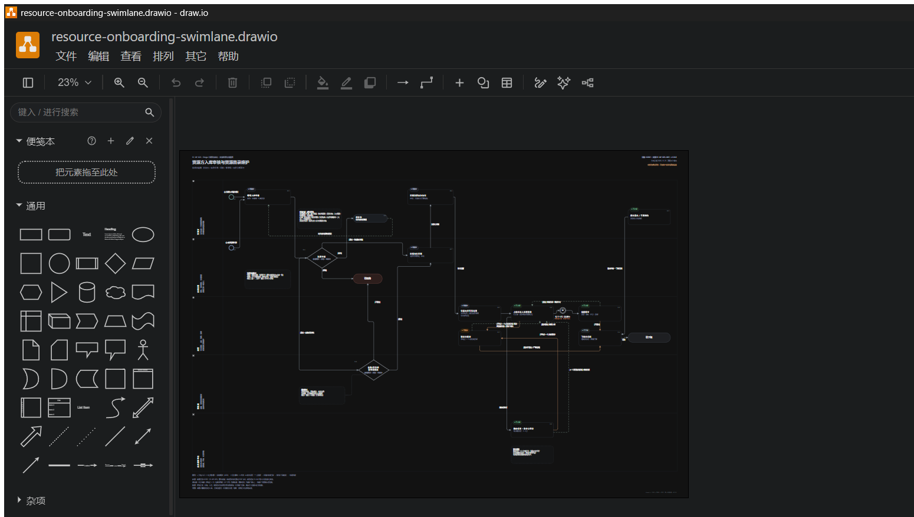
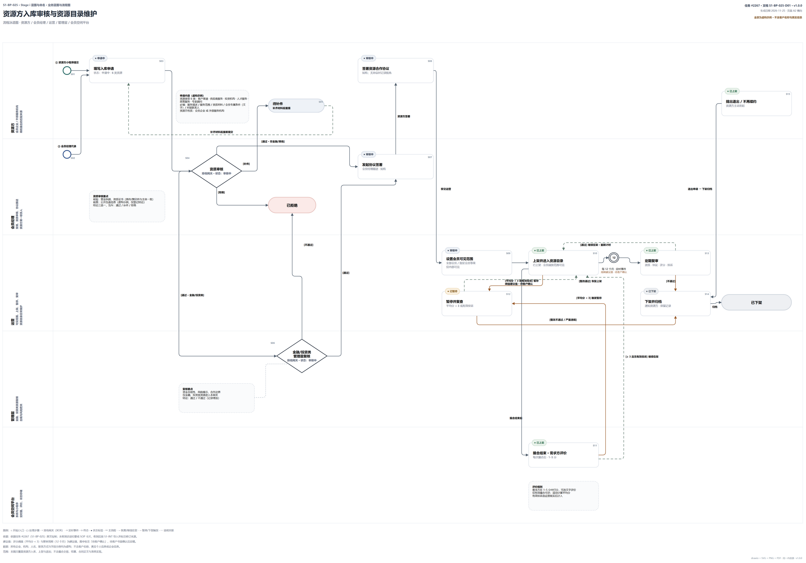

# draw.io 实开验证记录 · #2267（S1-BP-025）

- 验证日期：2026-11-25
- 验证对象：`diagram/resource-onboarding-swimlane.drawio`
- drawio SHA-256：`df03bb2abaa208046bf10a735abf7af3d5bbbdf7fc37c894571f6910cf9c4d03`
- 结论：**PASS**（桌面版打开、解析、导出成功；可编辑；文字未溢出）

## 1. 环境与方法

| 项目 | 值 |
|---|---|
| 操作系统 | Windows 11 |
| 应用 | draw.io Desktop 32.7.4（JGraph.Draw） |
| 安装方式 | `winget install --id JGraph.Draw --version 32.7.4 --exact --silent --accept-package-agreements --accept-source-agreements`（exit 0） |
| 版本核验 | `drawio.exe --version` → `32.7.4`（exit 0） |
| 打开方式 | 桌面版双击/命令行打开 `.drawio`，编辑器窗口标题为 `resource-onboarding-swimlane.drawio - draw.io` |
| 导出核验 | `drawio.exe --export --format png --output docs/drawio-export.png --scale 1 --border 8 --no-sandbox --disable-gpu diagram/resource-onboarding-swimlane.drawio`（exit 0，2880×2014） |
| 截图 | `docs/drawio-open-check.png`（桌面版窗口，1550×878）；`docs/drawio-export.png`（draw.io 自身浅色渲染，2880×2014） |

> 桌面版跟随系统深色主题，GUI 截图为深色；同一文件用 draw.io CLI 以浅色渲染导出 `drawio-export.png`，用于清晰核对文字。未在 GUI 中保存任何修改，磁盘文件 SHA 与验证前一致。

## 2. 打开截图

桌面版窗口（含工具栏、图形面板、画布，处于可编辑状态）：



draw.io 自身浅色导出（用于文字与数量核对）：



## 3. 检查项

| 检查项 | 结果 | 证据/说明 |
|---|---|---|
| 5 条岗位泳道 | PASS | 资源方、会员经理、运营、管理层、会员空间平台；XML 解析 5 个 lane 对象 |
| 2 个排他网关 | PASS | 资质审核（通过/补件/拒绝）、金融/投资类管理层复核（通过/不通过）；2 个 rhombus，× 标记 |
| 15 个步骤 | PASS | S01–S15 共 15 个 `step` 对象，15 个 `badge-*` 角标；与 `docs/step-table.md` 一一对应 |
| 7 个状态 | PASS | 申请中、待补件、审核中、已上架、已暂停、已下架、已拒绝；10 个 `chip-*` 状态标签 + 待补件胶囊 + 已拒绝/已下架终态 + 两个网关的“状态：审核中”副标题 |
| 定时事件 | PASS | 1 个双圆时钟节点，标签“每 12 个月 · 定时事件 / 周期建议值 · 待客户确认” |
| 文字不溢出 | PASS | 2880×2014 导出图逐区目检；定时器标签、P4 两行副标题、S14 旁“归档”标签均已修正；无截断、无压边 |
| 可编辑 | PASS | 泳道为 swimlane 容器，步骤为 15 个顶点对象，网关为 2 个菱形，连线为 edge 对象；GUI 工具栏/图形面板正常，非只读预览、无报错页 |
| 页眉/页脚 | PASS | 标题、任务/版本、虚构数据提示、图例、4 条脚注均在导出中可见 |

XML 解析计数（本机命令输出摘要）：

```text
lanes=5 ["资源方","会员经理","运营","管理层","会员空间平台"]
xor=2, timers=1, steps=15 (S01..S15), states=7
state_chips=10, step_badges=15, terminals=["已拒绝","已下架"]
```

## 4. 观察与限制

1. **主题差异**：桌面版为系统深色主题，GUI 截图偏暗；`drawio-export.png` 为 draw.io 浅色渲染，是文字核对的依据。
2. **泳道标题方向**：drawio 使用 `horizontal=0` 的纵向泳道，标题文字旋转 90°；SVG/PNG/PDF 使用水平标签带。这是 drawio 原生泳道的呈现方式，不影响 5 条泳道与节点归属。
3. **缩放**：GUI 截图约 23% 缩放，适合证明“能打开、可编辑”；逐字核对以 2880×2014 的导出图和 SVG/PNG 为准。
4. **未保存**：GUI 中的视图操作（缩放/网格）未保存，磁盘文件未被 drawio 改写；文件 SHA 与验证前一致。
5. **CLI 导出**：draw.io 32.7.4 的导出器成功解析 mxfile/object/child-label 结构，退出码 0，说明文件不是“只有扩展名的坏文件”。

## 5. 结论

桌面版 draw.io 32.7.4 **实际打开并导出成功**。5 泳道、2 个排他网关、15 步、7 状态、定时事件均可核对，文字未见溢出，图形可编辑。未发现阻断问题。
